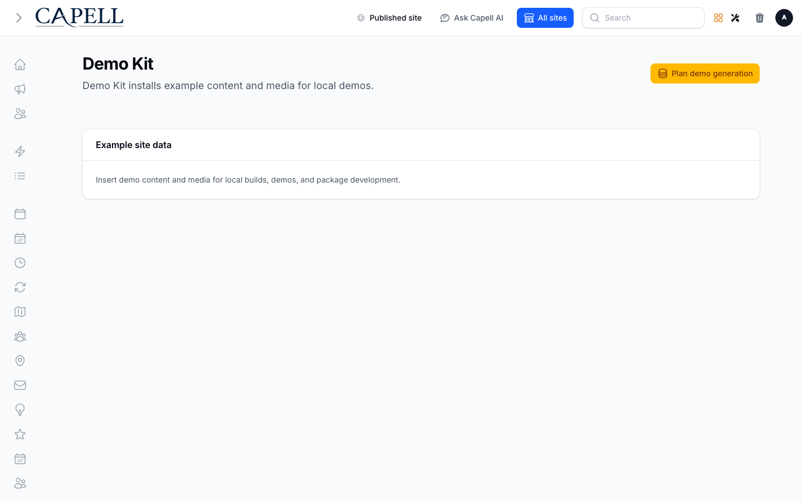
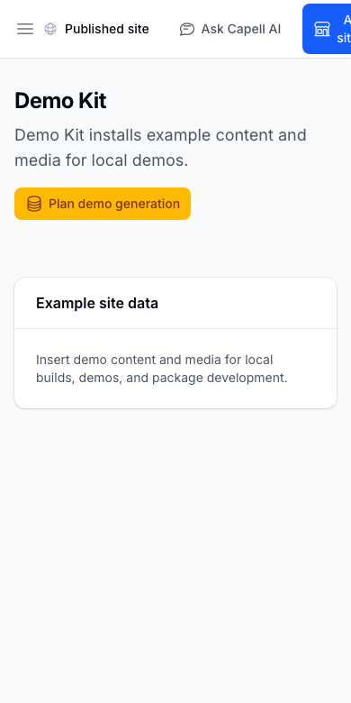

# Demo Kit

<!-- prettier-ignore-start -->

## What It Does

Demo Kit creates deterministic demo users, sites, languages, pages, media, and package examples from a repeatable generation plan.

- **Price and availability:** Check current availability and price on the [Capell Marketplace listing](https://capell.app/extensions/demo-kit).
- **Licence:** Check the licence terms on the [Capell Marketplace listing](https://capell.app/extensions/demo-kit).
- **Requires:** `PHP ^8.4`, `capell-app/admin ^1.0.66`, `capell-app/core ^1.0.75`, `capell-app/frontend ^1.0`, `capell-app/layout-builder ^1.0`, `capell-app/theme-foundation ^1.0`, `fakerphp/faker ^1.24.1`.
- **Install:** `composer require capell-app/demo-kit`.

Administrators can start demo generation from a package page or console command, then inspect the generated pages and components on the frontend.

## Who It Is For

**For developers:** Typed generation plans and package demo command orchestration make local setup, screenshots, and QA data reproducible from a chosen seed.

**For teams:** Teams can evaluate a populated site before entering real content and reset the sample state between demos, with explicit guards against production seeding.

## Quick Start

1. Install the package: `composer require capell-app/demo-kit`.
2. For developers and operators preparing a local or demo site: A local or testing environment, and permission to manage extensions. The page is not available in production.
3. Open `/admin/demo-kit`. Choose **Plan demo generation**, enter the site URL and any sites and languages, then review the plan. Choose **Queue reviewed generation** and confirm.
4. Check the result: The page reports that generation is queued, then that example site data was generated, with **Edit site** and **View public page** links for each site. Next: Run `php artisan capell:demo-kit-doctor` to check the generated data, and replace the sample content before launch.

## Configure

- **Configuration files:** `config/capell-demo-kit.php`.
- **Commands:** `php artisan capell:admin-demo`, `php artisan capell:demo`, `php artisan capell:demo-kit-doctor`, `php artisan capell:demo-kit-full-demo`, `php artisan capell:demo-kit-kitchen-sink`, `php artisan capell:demo-kit-refresh-stitch-pages`, `php artisan capell:demo-kit-screenshot-fixture`.

## Limits And Pitfalls

- Install the required Capell packages at the versions in `composer.json`: `capell-app/admin ^1.0.66`, `capell-app/core ^1.0.75`, `capell-app/frontend ^1.0`, `capell-app/layout-builder ^1.0`, `capell-app/theme-foundation ^1.0`.
- Run migrations before opening package resources or public routes.
- Keep public Blade and cached HTML free of authoring markers, model IDs, permissions, signed editor URLs, and lazy database queries.
- Custom write integrations must preserve invalidation for `demo-kit` cache tags.

## Screens And Workflow

- Demo Kit ready to plan (admin).
- Demo Kit ready to plan on mobile (admin).
- Recommended generation profile (admin).
- Recommended generation profile on mobile (admin).
- Custom generation profile (admin).
- Custom generation profile on mobile (admin).
- Generation review before confirmation (admin).
- Generation review before confirmation on mobile (admin).
- Review of reusable generated sites (admin).
- Review of reusable generated sites on mobile (admin).
- Review blocked by ordinary content (admin).
- Review blocked by ordinary content on mobile (admin).
- Explicit generation confirmation (admin).
- Explicit generation confirmation on mobile (admin).
- Queued generation (admin).
- Queued generation on mobile (admin).
- Running generation (admin).
- Running generation on mobile (admin).
- Completed generation and created content (admin).
- Completed generation and created content on mobile (admin).
- Failed generation with redacted error (admin).
- Failed generation with redacted error on mobile (admin).
- Stalled generation requiring a new review (admin).
- Stalled generation requiring a new review on mobile (admin).
- Provenance-only reset confirmation (admin).
- Provenance-only reset confirmation on mobile (admin).
- Demo Kit with navigation open (admin).
- Demo Kit with navigation open on mobile (admin).
- Insights consent priming capture (frontend).
- Generated demo page content widget (frontend).
- Generated homepage section widget (frontend).

## Install Impact

- Required packages: `capell-app/admin`, `capell-app/core`, `capell-app/frontend`, `capell-app/layout-builder`, `capell-app/theme-foundation`.
- Admin navigation: declares `admin-page: DemoKitAdminPageContribution`; each Filament page or resource controls its own navigation visibility.
- Admin/editor extensions: `configurator: DemoKitConfiguratorContribution`, `dashboard-widget: DemoKitRenderablesContribution`.
- Permissions: Shield-generated page permissions for `Capell\DemoKit\Filament\Pages\DemoKitPage` (names and grants depend on host Shield configuration).
- Public routes: none declared.
- Database changes: package migrations are declared.
- Config: `config/capell-demo-kit.php`.
- Settings: no package settings declared.
- Queues or schedules: queue jobs `RunDemoKitGenerationJob`.
- Cache tags: `demo-kit`.
- Commands: `capell:admin-demo`, `capell:demo`, `capell:demo-kit-doctor`, `capell:demo-kit-full-demo`, `capell:demo-kit-kitchen-sink`, `capell:demo-kit-refresh-stitch-pages`, `capell:demo-kit-screenshot-fixture`.

## Troubleshooting

| Symptom | Likely cause | Check | Fix |
| --- | --- | --- | --- |
| Package health check reports a problem | Package configuration or runtime dependencies are not ready | Run `php artisan capell:demo-kit-doctor` | Follow the reported checks, then rerun the doctor command |
| Package surface is missing after install | Provider or manifest is not loaded | Confirm `capell.json`, package `composer.json`, and provider registration | Reinstall the package, refresh Composer autoload, and clear host caches |
| Admin screen or command fails on missing table | Package migrations have not run | Check the tables listed in `Data Model` | Run host migrations and rerun the focused package test |
| Background work does not run | Queue worker or declared schedule is not active | Check the jobs and scheduled commands listed in `Technical Shape` | Start the queue worker or host scheduler, then run the focused command or package test |
| Public output leaks unexpected state | Render data, cache variation, or authoring boundary has regressed | Check public Blade, cache tags, and public-output safety tests | Move data loading out of Blade and rerun the package public-output tests |

## Upgrading

No manual steps between minor versions.

Read [CHANGELOG.md](CHANGELOG.md) before upgrading.

## Next Steps

- [Package docs](docs/README.md)
- [Overview](docs/overview.md)
- Configuration files: [`config/capell-demo-kit.php`](config/capell-demo-kit.php).
- [Troubleshooting](#troubleshooting)
- [Developer reference](docs/reference.md)
- [Marketplace assets](docs/assets/marketplace/)
- [Capell content language plan](../../docs/CONTENT_LANGUAGE_PLAN.md)
- [Capell documentation design system](../../docs/DESIGN_SYSTEM.md)
- [Capell and package ERD notes](../../docs/erd/capell-and-package-erds.md)
- Related packages: [Layout Builder](../layout-builder/README.md), [Foundation Theme](../theme-foundation/README.md).

<!-- prettier-ignore-end -->
